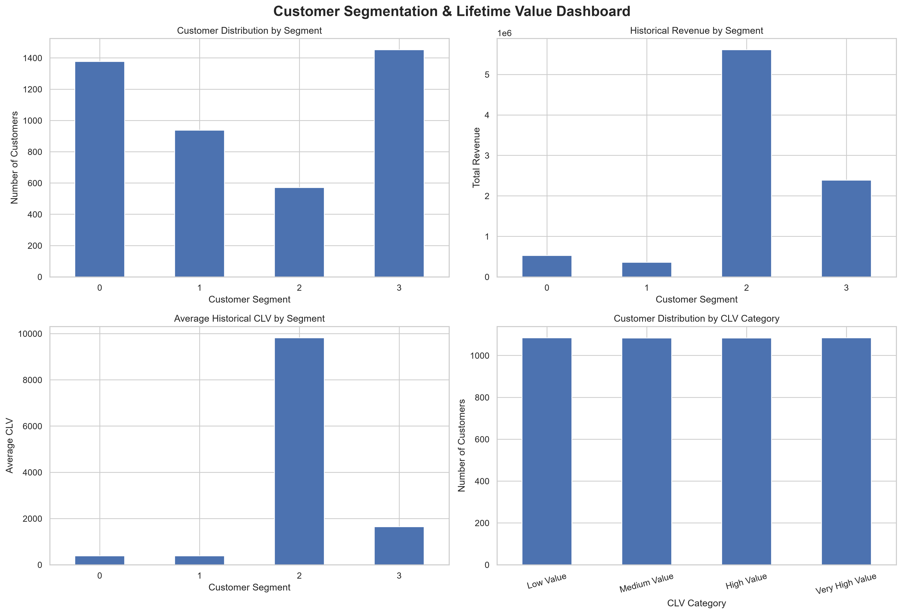

# Customer Segmentation and Customer Lifetime Value (CLV) Analysis

## Infyntrek Data Analyst Internship — Project 2

**Project Title:** Customer Segmentation and Lifetime Value (CLV) Analysis  
**Prepared by:** Prensi  
**Role:** Data Analyst Intern  
**Organization:** Infyntrek  
**Project Type:** Data Analytics | Customer Segmentation | CLV Analysis  
**Tools & Technologies:** Python, Pandas, NumPy, Scikit-learn, Matplotlib, Seaborn, SQL, Power BI, Jupyter Notebook

---

## 1. Project Overview

Customer Segmentation and Customer Lifetime Value (CLV) Analysis is a data analytics project focused on understanding customer purchasing behavior, identifying valuable customer groups, and evaluating their contribution to business revenue.

The project uses transactional retail data to perform RFM analysis, customer segmentation using K-Means clustering, and historical Customer Lifetime Value analysis.

The objective is to transform raw transaction data into meaningful business insights that can support customer retention, targeted marketing, and data-driven decision-making.

> **Dataset Note:** The analysis is based on the Online Retail dataset. It is used as a practical retail dataset for the internship project and does not represent actual Infyntrek fintech customer data.

---

## 2. Project Objectives

The key objectives of this project are:

- Analyze customer purchasing behavior using transactional data.
- Perform data cleaning and preprocessing.
- Calculate Recency, Frequency, and Monetary (RFM) metrics.
- Segment customers using the K-Means clustering algorithm.
- Analyze historical Customer Lifetime Value (CLV).
- Identify high-value and inactive customers.
- Evaluate revenue contribution across customer segments.
- Develop actionable business recommendations.
- Build an interactive Power BI dashboard for business insights.

---

## 3. Dataset Description

The project uses the **Online Retail dataset**, which contains transactional records of a UK-based online retail business.

### Key Dataset Attributes

| Column | Description |
|---|---|
| InvoiceNo | Transaction or invoice number |
| StockCode | Product identifier |
| Description | Product description |
| Quantity | Quantity purchased |
| InvoiceDate | Date and time of transaction |
| UnitPrice | Price per unit |
| CustomerID | Unique customer identifier |
| Country | Customer's country |

The dataset was processed to prepare customer-level metrics for segmentation and CLV analysis.

---

## 4. Tools and Technologies

| Tool / Technology | Purpose |
|---|---|
| Python | Data analysis and processing |
| Pandas | Data manipulation and cleaning |
| NumPy | Numerical calculations |
| Scikit-learn | K-Means clustering and evaluation |
| Matplotlib | Data visualization |
| Seaborn | Statistical visualization |
| SQL | Customer-level data analysis |
| SQLite | Database storage and querying |
| Jupyter Notebook | Analysis workflow |
| Power BI | Interactive dashboard development |
| Git & GitHub | Version control and project sharing |

---

## 5. Project Methodology

### Step 1: Data Collection

The Online Retail dataset was imported into the project environment for analysis.

### Step 2: Data Cleaning and Preparation

The data preparation process included:

- Inspecting the dataset structure.
- Handling missing customer identifiers.
- Preparing transaction-level data.
- Creating cleaned and processed datasets.
- Preparing customer-level data for analysis.

### Step 3: RFM Analysis

RFM analysis was performed using three customer behavior metrics:

- **Recency:** How recently a customer made a purchase.
- **Frequency:** How frequently a customer purchased.
- **Monetary:** The total monetary value of a customer's purchases.

These metrics were used to understand customer behavior and prepare customer segmentation.

### Step 4: Customer Segmentation

The K-Means clustering algorithm was used to group customers based on their RFM characteristics.

The clustering process included:

- Preparing RFM features.
- Scaling the features.
- Comparing different cluster counts.
- Evaluating clustering quality using the Silhouette Score.
- Interpreting the resulting customer segments.

The final customer segmentation was used to identify groups with different purchasing patterns and business value.

### Step 5: Customer Lifetime Value Analysis

Historical CLV was calculated using customers' observed monetary contribution in the dataset.

The analysis included:

- Historical CLV calculation.
- Customer ranking by CLV.
- CLV category classification.
- Average CLV by customer segment.
- Revenue contribution analysis.
- Customer retention analysis based on Recency.

**CLV Limitation:** This project analyzes historical customer value. It does not implement a predictive future CLV model.

### Step 6: Data Visualization

Visualizations were created to communicate key findings, including:

- Customer segment distribution.
- RFM cluster profiles.
- CLV distribution.
- CLV category distribution.
- Average CLV by customer segment.
- Revenue contribution by segment.
- Recency versus CLV.

### Step 7: Power BI Dashboard

An interactive Power BI dashboard was developed to present customer segmentation and CLV findings.

The dashboard includes:

- KPI cards.
- Customer value metrics.
- Customer segmentation charts.
- Revenue contribution analysis.
- CLV category analysis.
- Interactive slicers for filtering the analysis.

---

## 6. Key Analysis Results

### Overall CLV Analysis

| Metric | Result |
|---|---:|
| Total Historical Revenue | 8,887,208.89 |
| Average Historical CLV | 2,048.69 |
| Median Historical CLV | 668.57 |
| Average Order Value | 417.65 |
| Average Purchase Frequency | 4.27 |

*Note: Monetary values are reported in the dataset's currency, GBP.*

### CLV Category Analysis

Customers were categorized into four historical CLV groups.

| CLV Category | Customers | Average CLV | Total Revenue |
|---|---:|---:|---:|
| Low Value | 1,085 | 178.03 | 193,166.38 |
| Medium Value | 1,084 | 461.91 | 500,706.78 |
| High Value | 1,084 | 1,066.18 | 1,155,744.35 |
| Very High Value | 1,085 | 6,486.26 | 7,037,591.38 |

The Very High Value category contributes the largest share of historical revenue.

### Customer Segment Analysis

| Cluster | Customers | Average CLV | Revenue Contribution |
|---|---:|---:|---:|
| Cluster 0 | 1,377 | 384.22 | 5.95% |
| Cluster 1 | 938 | 385.39 | 4.07% |
| Cluster 2 | 571 | 9,823.43 | 63.12% |
| Cluster 3 | 1,452 | 1,644.26 | 26.86% |

Cluster 2 has the highest average CLV and contributes approximately 63.12% of total revenue despite representing approximately 13.16% of customers.

### Customer Retention Analysis

Customers were classified using a Recency threshold of 90 days.

| Customer Group | Customers | Customer Share | Total Revenue |
|---|---:|---:|---:|
| Recently Active | 2,889 | 66.6% | 7,854,666.60 |
| Inactive | 1,449 | 33.4% | 1,032,542.29 |

Approximately one-third of customers were classified as inactive based on the selected Recency threshold.

---

## 7. Key Business Insights

1. **High-value customer concentration:** A relatively small group of customers contributes a substantial share of historical revenue.

2. **Cluster 2 is the most valuable segment:** It has the highest average CLV and contributes approximately 63.12% of total revenue.

3. **Customer retention opportunity:** Approximately 33.4% of customers are classified as inactive using the 90-day Recency threshold.

4. **Different customer behaviors:** Customer clusters vary in purchase frequency, recency, and monetary contribution.

5. **CLV-based customer prioritization:** Categorizing customers by historical value can help businesses prioritize retention and engagement efforts.

---

## 8. Business Recommendations

### 1. Retain High-Value Customers

Develop loyalty programs, personalized offers, and premium customer experiences for customers with high historical CLV.

### 2. Reactivate Inactive Customers

Launch targeted reactivation campaigns for customers who have not purchased recently.

### 3. Improve Customer Engagement

Use segment-specific communication and offers based on customer purchasing patterns.

### 4. Focus on Revenue-Contributing Segments

Prioritize retention strategies for segments that contribute a significant share of total revenue.

### 5. Monitor Customer Value

Regularly update RFM metrics and CLV analysis to monitor changes in customer behavior and business performance.

---

## 9. Power BI Dashboard

The Power BI dashboard provides an interactive view of customer segmentation and historical CLV.

Dashboard features include:

- KPI cards for key business metrics.
- CLV category analysis.
- Average CLV by customer segment.
- Customer revenue contribution.
- Interactive filtering using slicers.
- Visual representation of customer value and behavior.

### Dashboard Preview



The Power BI dashboard file is available in the project repository:

`Customer_Segmentation_CLV_Dashboard.pbix`

---

## 10. Project Structure

```text
Customer Segmentation and Lifetime Value (CLV) Analysis/
│
├── Customer_Segmentation_CLV.ipynb
├── Customer_Segmentation_CLV_Dashboard.pbix
├── Customer_Segmentation_CLV_Project_Presentation.pptx
├── README.md
├── requirements.txt
│
├── Data/
│   ├── Online Retail.xlsx
│   └── processed/
│       ├── cleaned_transactions.csv
│       ├── customer_rfm.csv
│       ├── customer_segments.csv
│       ├── customer_clv_analysis.csv
│       ├── customer_clv_ranking.csv
│       ├── clv_category_analysis.csv
│       ├── segment_clv_analysis.csv
│       └── other analysis outputs
│
├── Database/
│   └── customer_segmentation.db
│
├── sql/
│   └── customer_rfm_analysis.sql
│
└── reports/
    ├── week2_summary.md
    ├── week3_summary.md
    ├── week4_final_project_report.md
    ├── week4_final_dashboard.png
    └── analysis charts
```

---

## 11. How to Run the Project

### Prerequisites

- Python 3.x
- Jupyter Notebook
- Power BI Desktop
- Git

### Step 1: Clone the Repository

```bash
git clone https://github.com/prensi01/infyntrek-customer-segmentation-clv-analysis.git
```

### Step 2: Navigate to the Project Folder

```bash
cd infyntrek-customer-segmentation-clv-analysis
```

### Step 3: Install Dependencies

```bash
pip install -r requirements.txt
```

### Step 4: Run the Jupyter Notebook

Open the notebook:

`Customer_Segmentation_CLV.ipynb`

Run the cells sequentially to review the analysis workflow.

### Step 5: Open the Power BI Dashboard

Open:

`Customer_Segmentation_CLV_Dashboard.pbix`

using Power BI Desktop.

---

## 12. Limitations

- The analysis is based on historical transactional retail data.
- The dataset does not represent actual Infyntrek fintech customer data.
- Historical CLV is not a prediction of future customer value.
- Customer segmentation results depend on the selected features and clustering configuration.
- The inactive customer classification uses a selected Recency threshold of 90 days.
- Business recommendations should be validated against real business data before implementation.

---

## 13. Conclusion

This project demonstrates an end-to-end customer analytics workflow, including data preparation, RFM analysis, K-Means customer segmentation, historical CLV analysis, SQL-based analysis, data visualization, and Power BI dashboard development.

The analysis identified customer groups with different purchasing behaviors and revenue contributions. The findings provide a foundation for customer retention, targeted marketing, and customer value-based business strategies.

The project strengthened practical skills in Python, SQL, data analytics, customer segmentation, visualization, and business insight generation.

---

## 14. GitHub Repository

**Project Repository:**  
https://github.com/prensi01/infyntrek-customer-segmentation-clv-analysis

---

## Acknowledgment

This project was completed as part of the Data Analyst Internship at Infyntrek, with the objective of developing practical skills in customer analytics and data-driven business decision-making.

